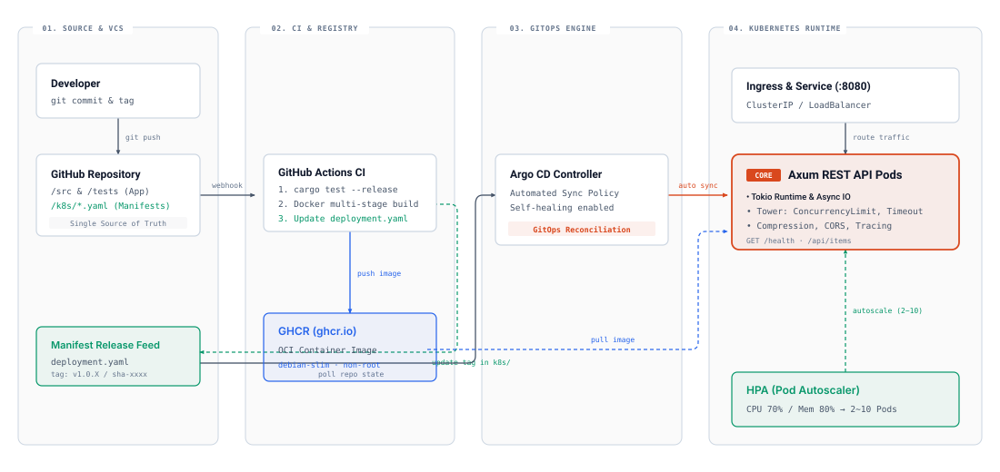

# 🦀 Rust API Server

> Axum 기반 고성능 REST API 서버 + Argo CD GitOps 배포 파이프라인


## 아키텍처

```
Developer → GitHub → GitHub Actions → GHCR (이미지 빌드)
                                     ↓
                              k8s/ 매니페스트 태그 업데이트
                                     ↓
                              Argo CD (변경 감지 → Sync)
                                     ↓
                              Kubernetes Cluster (HPA 오토스케일링)
```

## 기술 스택

| 영역 | 기술 |
|---|---|
| **백엔드** | Rust, Axum 0.8, Tokio |
| **미들웨어** | Tower (ConcurrencyLimit, Timeout, Compression, CORS) |
| **컨테이너** | Docker 멀티 스테이지 빌드 (debian-slim, non-root) |
| **오케스트레이션** | Kubernetes (Deployment, Service, HPA) |
| **CI/CD** | GitHub Actions → GHCR 이미지 Push → 매니페스트 태그 업데이트 |
| **GitOps** | Argo CD (k8s/ 디렉토리 감시) |

## 빠른 시작

### 로컬 실행

```bash
# 빌드 및 실행
cargo run

# 릴리스 모드
cargo run --release
```

서버가 `http://localhost:8080` 에서 실행됩니다.

### Docker 실행

```bash
docker build -t rust-api .
docker run -p 8080:8080 rust-api
```

## API 레퍼런스

| Method | Endpoint | 설명 | 인증 (`API_KEY` 설정 시) |
|---|---|---|---|
| `GET` | `/health` | 헬스체크 | 불필요 |
| `GET` | `/api/items` | 전체 아이템 조회 | 불필요 |
| `GET` | `/api/items/{id}` | 단일 아이템 조회 | 불필요 |
| `POST` | `/api/items` | 아이템 생성 | `x-api-key` 또는 `Bearer` 토큰 |
| `PUT` | `/api/items/{id}` | 아이템 수정 | `x-api-key` 또는 `Bearer` 토큰 |
| `DELETE` | `/api/items/{id}` | 아이템 삭제 | `x-api-key` 또는 `Bearer` 토큰 |

### 환경변수 설정

| 환경변수 | 기본값 | 설명 |
|---|---|---|
| `RUST_LOG` | `rust_api=debug,tower_http=debug` | 로그 레벨 필터 |
| `ALLOWED_ORIGINS` | `http://localhost:3000,http://localhost:8080` | 허용할 CORS Origin 목록 (쉼표 구분) |
| `API_KEY` | *(미설정 시 비활성화)* | 쓰기 요청(`POST`/`PUT`/`DELETE`) 보호용 API 키 |

### 요청 예시

```bash
# 헬스체크
curl http://localhost:8080/health

# 아이템 생성 (API_KEY 설정 시 -H "x-api-key: <KEY>" 추가)
curl -X POST http://localhost:8080/api/items \
  -H "Content-Type: application/json" \
  -d '{"title": "Hello", "content": "World"}'

# 전체 조회
curl http://localhost:8080/api/items
```

## 프로젝트 구조 (실용적 헥사고날 아키텍처 — Ports & Adapters)

```text
├── src/
│   ├── main.rs                         # [Binary] 엔트리포인트 (~30줄): 로깅, DI 조립, 서버 실행
│   ├── lib.rs                          # [Library] 모듈 외부 노출 (통합 테스트 및 재사용 지원)
│   ├── config.rs                       # 환경변수 1회 로드 및 캐싱 (ALLOWED_ORIGINS, API_KEY, PORT)
│   ├── telemetry.rs                    # 구조화 로깅 초기화 & SIGTERM/Ctrl+C Graceful Shutdown
│   ├── domain/                         # [Core] 외부 웹/DB 프레임워크 의존성 Zero
│   │   ├── model.rs                    # Item 엔티티, 도메인 불변식 및 길이 검증
│   │   ├── error.rs                    # AppError 정의
│   │   └── port.rs                     # ItemRepository 트레이트 (RPITIT 정적 디스패치 Port)
│   └── adapters/                       # [Adapters] 외부 세계와의 연결
│       ├── inbound/
│       │   ├── http/                   # Axum 라우터, 핸들러, CORS/API Key 미들웨어
│       │   └── cli.rs                  # 컨테이너 자체 헬스체크 프로브 (`--healthcheck`)
│       └── outbound/
│           └── memory_repo.rs          # InMemoryItemRepository (ItemRepository 구현체)
├── Dockerfile                          # 멀티 스테이지 빌드 (보안 강화 + 자체 헬스체크)
├── k8s/
│   ├── deployment.yaml                 # K8s Deployment (Rolling Update + Restricted SecurityContext)
│   ├── service.yaml                    # K8s Service (ClusterIP)
│   └── hpa.yaml                        # HorizontalPodAutoscaler (2~10 Pods)
└── .github/workflows/
    └── ci-cd.yaml                      # CI/CD 파이프라인 (RustSec 보안 감사 포함)
```

## 고성능 설계

- **ConcurrencyLimit**: 동시 요청 수 1024 제한으로 과부하 방지
- **Request Timeout**: 10초 타임아웃으로 느린 요청 강제 종료 (`408 Request Timeout`)
- **Gzip Compression**: 응답 압축으로 대역폭 절약
- **Graceful Shutdown**: `SIGTERM` / `Ctrl+C` 수신 시 진행 중인 요청 완료 후 안전한 종료
- **HPA Auto-scaling**: CPU 50% 기준 2→10 Pod 자동 스케일링
- **Rolling Update**: `maxUnavailable: 0`으로 무중단 배포

## 보안 설계

- **애플리케이션 보안**:
  - 최소 권한 CORS 정책 (`ALLOWED_ORIGINS` 기반 Origin 제한 및 명시적 메서드/헤더 허용)
  - 상수 시간 비교(`constant_time_eq`)를 적용한 API Key 인증 미들웨어로 타이밍 공격 완화
  - 요청 본문 크기 제한 (`64 KiB`), 필드 길이 제한 및 인메모리 최대 저장 개수(`10,000`개) 제한으로 메모리 고갈(DoS) 방어
- **컨테이너 보안**:
  - `debian:bookworm-slim` 멀티 스테이지 빌드로 소스 코드 및 빌드 도구 완전 배제
  - Non-root 유저(`UID/GID 10001`), 바이너리 읽기/실행 전용 권한(`chmod 555`)
  - `curl`/`wget` 등 외부 네트워크 도구를 설치하지 않는 자체 바이너리 헬스체크(`rust-api --healthcheck`)
- **Kubernetes 보안 (Pod Security Standards — Restricted)**:
  - `automountServiceAccountToken: false`로 불필요한 K8s API 자격증명 마운트 차단
  - `seccompProfile: RuntimeDefault`, `readOnlyRootFilesystem: true`, `allowPrivilegeEscalation: false`
  - Linux Capabilities 전체 제거 (`drop: ["ALL"]`)
- **CI/CD 공급망 보안**:
  - 워크플로우 기본 권한 `contents: read` 제한 (최소 권한 원칙)
  - `rustsec/audit-check`를 통한 의존성 크레이트 보안 취약점 자동 검사

## 배포 (GitOps)

1. `main` 브랜치에 코드 Push
2. GitHub Actions가 Docker 이미지를 빌드하여 GHCR에 Push
3. `k8s/deployment.yaml`의 이미지 태그를 자동 업데이트
4. Argo CD가 변경을 감지하고 Kubernetes 클러스터에 Sync


