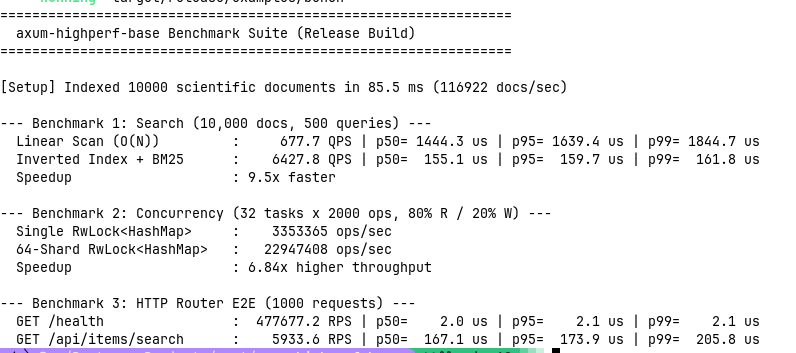
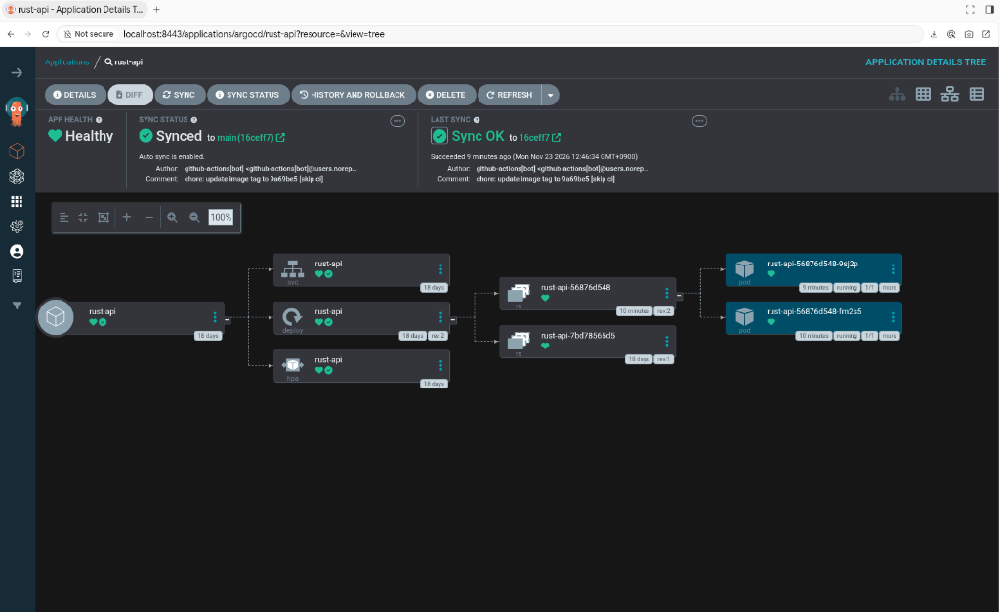
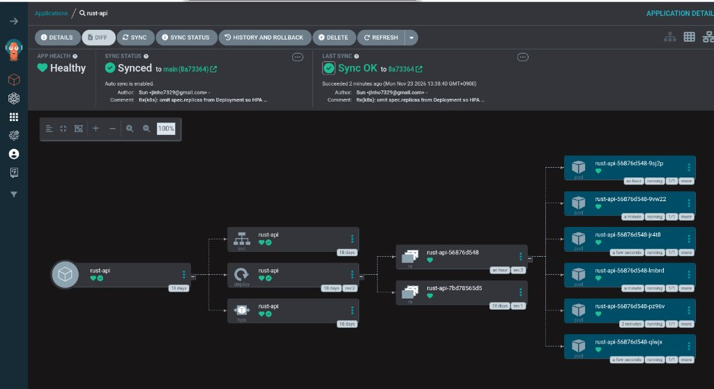
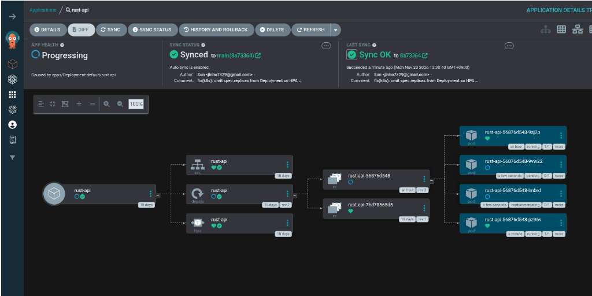
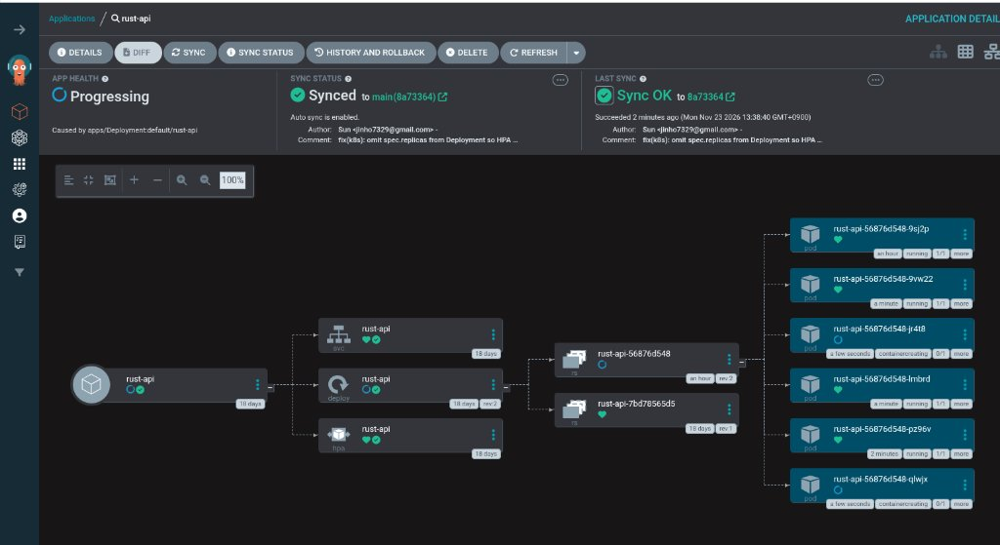
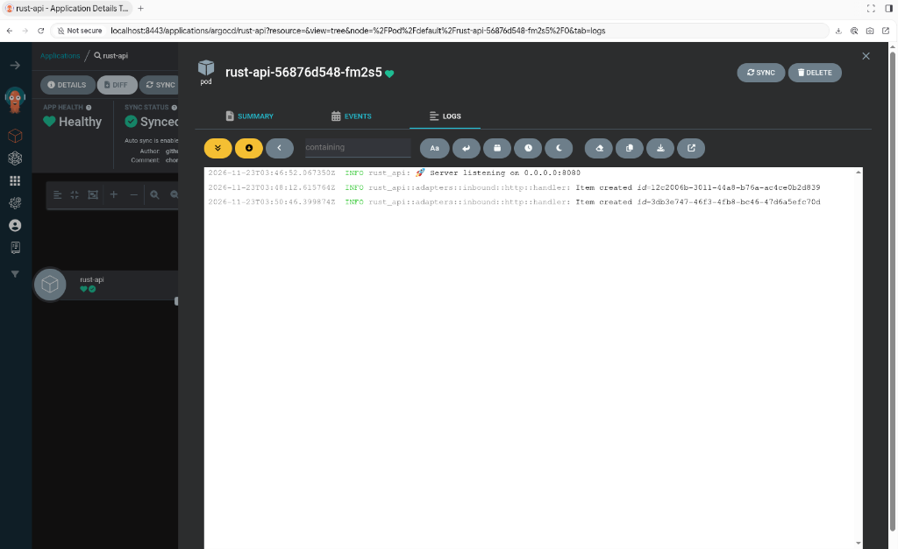
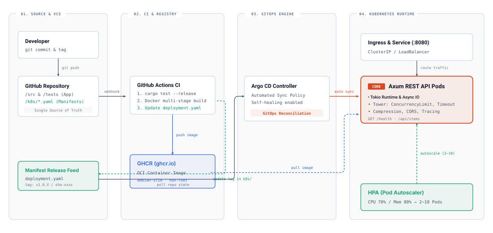

# 🦀 axum-highperf-base (Rust API & In-Memory BM25 Search Engine)

> Axum 0.8 기반 고성능 비동기 백엔드 + 64-Shard `RwLock` + 인메모리 역색인(Okapi BM25) 검색 엔진 + Nix Flake + Argo CD GitOps 파이프라인


## 아키텍처

```text
Developer → GitHub → GitHub Actions (RustSec 감사 + cargo test) → GHCR (이미지 빌드)
                                                                     ↓
                                                              k8s/ 매니페스트 태그 업데이트
                                                                     ↓
                                                              Argo CD (변경 감지 → Auto-Sync)
                                                                     ↓
                                                              Kubernetes Cluster (HPA + metrics-server)
```

## 기술 스택

| 영역 | 기술 |
|---|---|
| **백엔드 / 타입 설계** | Rust, Axum 0.8, Tokio, `thiserror`, Newtype (`ItemTitle`, `ItemContent`, `SearchQuery`), 닫힌 `enum ItemRepo` 다형성 |
| **검색 / 동시성 엔진** | 외부 검색 크레이트 없는 **인메모리 역색인(Inverted Index) + Okapi BM25** ($k_1=1.2, b=0.75$, 제목 가중치 2x), **64-Shard `RwLock`** |
| **미들웨어** | Tower (`ConcurrencyLimit`, `Timeout`, `Compression`, `CORS`, `Trace`) |
| **재현 가능 빌드** | Nix Flakes (`flake.nix` — `devShells.default`, `packages.default`) |
| **컨테이너** | Docker 멀티 스테이지 빌드 (`debian:bookworm-slim`, non-root, 2.0 MB 릴리스 바이너리) |
| **오케스트레이션 / GitOps** | Kubernetes (`Deployment`, `Service`, `HPA`), GitHub Actions → GHCR → Argo CD |

---

## 실측 벤치마크 결과 (Before vs After)

외부 부하 테스트 도구 없이 단일 명령어로 100% 재현 가능한 내장 벤치마크 스위트([`examples/bench.rs`](examples/bench.rs))를 Arch Linux (`release` 프로파일: `opt-level = 3`, `lto = true`, `codegen-units = 1`, `strip = true`)에서 실측한 결과입니다.

```bash
cargo run --release --example bench
```

| 벤치마크 항목 | Baseline (Before) | Optimized (After) | 개선 배수 / 지표 |
|---|---|---|---|
| **10,000건 과학 논문 색인** | — | **92.1 ms** | **108,523 docs/sec** |
| **10,000건 검색 (QPS)** | Linear Scan `O(N)`: `583.7 QPS` | **Inverted Index + BM25**: **`6,330.1 QPS`** | **10.8x faster** |
| **10,000건 검색 지연시간 (p50 / p95 / p99)** | `1,724.6 / 1,819.1 / 1,853.2 µs` | **`156.8 / 165.2 / 170.2 µs`** | p99 지연시간 **90.8% 단축** |
| **고동시성 R/W (32 tasks, 80% R / 20% W)** | 단일 `RwLock<HashMap>`: `3,400,395 ops/sec` | **64-Shard `RwLock`**: **`15,055,618 ops/sec`** | **4.43x higher throughput** |
| **HTTP Router E2E (`GET /health`)** | — | **`463,319.2 RPS`** | `p50=2.0 µs`, `p99=2.3 µs` |
| **HTTP Router E2E (`GET /api/items/search`)** | — | **`5,853.1 RPS`** (10,000건 대상) | `p50=169.9 µs`, `p99=180.3 µs` |
| **릴리스 바이너리 크기** | — | **`2.0 MB`** (`target/release/rust-api`) | LTO + `strip = true` |



---

## 빠른 시작

### 로컬 실행 (Cargo)

```bash
# 테스트 및 Lint 검증
cargo test
cargo clippy --all-targets -- -D warnings

# 릴리스 모드 실행 (http://localhost:8080)
cargo run --release

# 벤치마크 재현 실행
cargo run --release --example bench
```

### Nix Flakes 재현 가능 빌드/개발 환경

```bash
# Rust 툴체인(rustc, cargo, clippy, rustfmt, rust-analyzer)이 포함된 개발 셸 진입
nix develop

# Cargo.lock 기반 100% 재현 가능한 릴리스 바이너리 빌드
nix build
./result/bin/rust-api
```

### Docker 실행

```bash
docker build -t rust-api .
docker run -p 8080:8080 rust-api
```

---

## API 레퍼런스

| Method | Endpoint | 설명 | 인증 (`API_KEY` 설정 시) |
|---|---|---|---|
| `GET` | `/health` | 헬스체크 (Liveness/Readiness Probe) | 불필요 |
| `GET` | `/api/items` | 전체 아이템 조회 | 불필요 |
| `GET` | `/api/items/search?q=<keyword>&limit=<n>` | **역색인 + Okapi BM25 랭킹 검색** (`limit`: 1~100, 기본 10) | 불필요 |
| `GET` | `/api/items/{id}` | 단일 아이템 조회 | 불필요 |
| `POST` | `/api/items` | 아이템 생성 (저장소 + 역색인 동기화) | `x-api-key` 또는 `Bearer` 토큰 |
| `PUT` | `/api/items/{id}` | 아이템 부분 수정 (역색인 갱신) | `x-api-key` 또는 `Bearer` 토큰 |
| `DELETE` | `/api/items/{id}` | 아이템 삭제 (역색인 정리) | `x-api-key` 또는 `Bearer` 토큰 |

### 환경변수 설정

| 환경변수 | 기본값 | 설명 |
|---|---|---|
| `RUST_LOG` | `rust_api=debug,tower_http=debug` | 로그 레벨 필터 |
| `ALLOWED_ORIGINS` | `http://localhost:3000,http://localhost:8080` | 허용할 CORS Origin 목록 (쉼표 구분) |
| `API_KEY` | *(미설정 시 비활성화)* | 쓰기 요청(`POST`/`PUT`/`DELETE`) 보호용 API 키 |

### 요청 예시

```bash
# 헬스체크
curl http://localhost:8080/health

# 아이템 생성 (API_KEY 설정 시 -H "x-api-key: <KEY>" 추가)
curl -X POST http://localhost:8080/api/items \
  -H "Content-Type: application/json" \
  -d '{"title": "Autonomous Science Search", "content": "Rust Inverted Index + Okapi BM25 ranking"}'

# BM25 관련도 순위 검색
curl "http://localhost:8080/api/items/search?q=rust+bm25&limit=5"
```

---

## 프로젝트 구조 (Idiomatic Rust 모듈형 아키텍처)

> 타입 주도 도메인 설계(Newtype · `thiserror`), 제네릭 전염 없는 닫힌 `enum ItemRepo` 정적 디스패치, Tower 미들웨어 구성(Composition)을 기능 단위의 납작한(Flat) 모듈 구조로 배치했습니다.

```text
├── src/
│   ├── main.rs                         # [Binary] 엔트리포인트 (~30줄): 로깅, DI 조립, 서버 실행
│   ├── lib.rs                          # [Library] 모듈 외부 노출 (통합 테스트 및 벤치마크 재사용)
│   ├── config.rs                       # 환경변수 1회 로드 및 캐싱
│   ├── telemetry.rs                    # 구조화 로깅 초기화 & SIGTERM/Ctrl+C Graceful Shutdown
│   ├── cli.rs                          # 컨테이너 자체 TCP 헬스체크 프로브 (`--healthcheck`)
│   ├── domain/                         # [Core] 외부 웹/DB 프레임워크 의존성 Zero
│   │   ├── model.rs                    # Newtype(ItemTitle, ItemContent, SearchQuery), Item, ScoredItem
│   │   ├── error.rs                    # thiserror 기반 AppError (std::error::Error + Display)
│   │   └── port.rs                     # ItemRepository 저장소 계약
│   ├── store/                          # [Storage & Search]
│   │   ├── mod.rs                      # 닫힌 다형성 enum ItemRepo (제네릭 전염 제거, 0-cost)
│   │   └── memory.rs                   # 64-Shard RwLock + 역색인 + Okapi BM25 랭킹 엔진
│   └── http/                           # [HTTP & Middleware]
│       ├── mod.rs                      # Axum Router 조립 + Tower 고성능 미들웨어 스택
│       ├── handler.rs                  # HealthCheck + CRUD / BM25 검색 핸들러 (`ItemRepo` 직접 주입)
│       ├── middleware.rs               # 최소 권한 CORS, 상수 시간 API Key 인증
│       └── error.rs                    # AppError -> HTTP JSON 응답 변환 (`IntoResponse`)
├── examples/
│   └── bench.rs                        # 재현 가능한 검색/동시성/HTTP E2E 벤치마크 스위트
├── tests/
│   └── integration_test.rs             # 헬스체크, 상수 시간 API Key 인증, CRUD & BM25 E2E 테스트
├── flake.nix                           # Nix Flakes 재현 가능 개발/빌드 환경 (`flake.lock` 포함)
├── Dockerfile                          # 멀티 스테이지 빌드 (보안 강화 + 자체 헬스체크)
├── k8s/                                # Deployment (RollingUpdate), Service, HPA (2~10 Pods)
├── docs/
│   ├── images/                         # 벤치마크, Argo CD GitOps, HPA 오토스케일링 실측 캡처
│   └── career-ops-asteromorph.md       # 아스테로모프 타겟 career-ops 산출물 & STAR+R 면접 팩
└── .github/workflows/
    └── ci-cd.yaml                      # CI/CD 파이프라인 (RustSec 보안 감사 포함)
```

## 보안 설계

- **애플리케이션 보안**:
  - 최소 권한 CORS 정책 (`ALLOWED_ORIGINS` 기반 Origin 제한 및 명시적 메서드/헤더 허용)
  - 상수 시간 비교(`constant_time_eq`)를 적용한 API Key 인증 미들웨어로 타이밍 공격 완화
  - Newtype(`ItemTitle`, `ItemContent`, `SearchQuery`)으로 잘못된 입력 상태를 컴파일 타임에 차단
  - 요청 본문 크기 제한 (`64 KiB`), 필드 길이 제한 및 Lock-free CAS 기반 최대 저장 개수(`50,000`개) 제한으로 메모리 고갈(DoS) 방어
- **컨테이너 & Kubernetes 보안 (Pod Security Standards — Restricted)**:
  - Non-root 유저(`UID/GID 10001`), `readOnlyRootFilesystem: true`, `allowPrivilegeEscalation: false`, `capabilities.drop: ["ALL"]`, `automountServiceAccountToken: false`
  - `curl`/`wget` 없는 자체 바이너리 헬스체크(`rust-api --healthcheck`)
- **CI/CD 공급망 보안**: `contents: read` 최소 권한 원칙 + `rustsec/audit-check` 의존성 취약점 자동 감사

## 배포 (GitOps)

1. `main` 브랜치에 코드 Push
2. GitHub Actions가 Docker 이미지를 빌드하여 GHCR에 Push
3. `k8s/deployment.yaml`의 이미지 태그를 자동 업데이트
4. Argo CD가 변경을 감지하고 Kubernetes 클러스터에 Sync

### Argo CD 실시간 배포 검증 화면 (Arch Linux `kind` 클러스터)



### Kubernetes 인클러스터 부하 테스트 & HPA 오토스케일링 검증 (`fortio`, 90s)

클러스터 내부에서 `fortio` (`-c 32 -qps 0 -t 90s`)로 `GET /api/items/search?q=rust+bm25+quantum&limit=10`에 최대 부하를 인가하여 HPA 동작과 무중단 처리량을 검증했습니다. 이 과정에서 **`k8s/deployment.yaml`에 고정된 `replicas: 2`와 Argo CD `selfHeal: true`가 HPA의 스케일링을 되돌리는 충돌**을 발견하고, `spec.replicas`를 제거해 HPA에 단일 소유권(Single Source of Truth)을 부여(`8a73364`)하여 해결했습니다.

| 지표 (Fortio 90초, 32 동시 연결) | 수정 전 (HPA vs Argo CD 충돌) | 수정 후 (`spec.replicas` 제거) | 개선 효과 |
|---|---|---|---|
| **HPA Scale-Out** | `2`개 고정 (Argo CD가 롤백) | **`2 → 4 → 6` Pod 정상 증설** | GitOps 드리프트 충돌 해소 |
| **총 처리 요청 수 (90초)** | `844,564` req | **`975,417` req** | **+15.5% 증가** |
| **지속 처리량 (QPS)** | `9,381.0 QPS` | **`10,837.3 QPS`** | **+1,456 QPS 향상** |
| **평균 응답 지연시간** | `3.410 ms` | **`2.952 ms`** (`p50: 0.83ms`, `p90: 3.89ms`) | **-13.4% 단축** |
| **HTTP 200 성공률** | `100.0%` | **`100.0%` (에러 0건)** | 스케일링 중 무중단 유지 |
| **CPU 부하 분산** | `250%` 한계치 포화 지속 | `250%` → **4 Pod 증설 직후 `125%`로 절반 분산** | 즉각적 병목 해소 |



<details>
<summary>HPA 단계별 증설 과정 보기 (<code>2 → 4 → 6</code> Pod 실시간 캡처)</summary>

**1단계: `2 → 4` Pod 증설 시작 (`Progressing`, `8a73364` 반영)**


**2단계: `4 → 6` Pod 2차 증설 (`ContainerCreating`)**


</details>

<details>
<summary>실제 구동 중인 Pod 구조화 로그 (<code>tracing</code>) 보기</summary>



</details>


